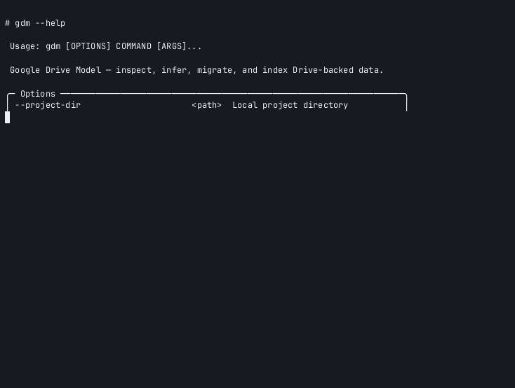

# Terminal demo

The repository includes an **asciinema v2 cast** and an animated GIF built from
**actual local CLI stdout** by `docs/assets/regenerate-demo.sh`. It is **not**
recorded with the interactive `asciinema rec` binary—no network calls,
credential prompts, or remote mutations occur.

## Provenance

| Property | Value |
| --- | --- |
| Recording method | `regenerate-demo.sh` runs real `uv run gdm` commands and writes an asciinema v2 event stream |
| Network | None (local infer file + local `--project-dir` init/doctor/adopt/index) |
| OAuth / Drive | Not invoked |
| Default mode | Global `--dry-run` (inspect-only) |

Commands recorded:

1. `gdm --help` (header)
2. `gdm infer file docs/assets/demo-sample.json`
3. `gdm --project-dir $TMP init --root-id demo-root-folder --force`
4. `gdm doctor`, `gdm adopt`, `gdm index rebuild` (dry-run)

## Files

| File | Purpose |
| --- | --- |
| [`demo.cast`](demo.cast) | Asciinema v2 event stream (generated, not `asciinema rec`) — **tracked** |
| [`demo.gif`](demo.gif) | Animated rendering of the cast — **tracked** (requires `agg` to regenerate) |
| [`demo-sample.json`](demo-sample.json) | Local JSON input for `infer file` — **tracked** |
| [`regenerate-demo.sh`](regenerate-demo.sh) | Re-record cast from live CLI output |

## Playback (local)

=== "asciinema CLI"

    ```console
    asciinema play docs/assets/demo.cast
    ```

=== "asciinema player (npm)"

    ```console
    npx asciinema-player docs/assets/demo.cast
    ```

=== "Embed in HTML"

    ```html
    <asciinema-player src="demo.cast" cols="100" rows="32"></asciinema-player>
    <script src="https://cdn.jsdelivr.net/npm/asciinema-player@3/dist/bundle/asciinema-player.min.js"></script>
    ```

## GIF animation

When [`agg`](https://github.com/asciinema/agg) is installed, the regeneration
script also writes `demo.gif`. The cast remains the canonical, playable source;
commit the GIF when you regenerate it locally with `agg` available.

## Regenerate

```console
bash docs/assets/regenerate-demo.sh
```

Requires `uv sync --all-groups` from the repository root.

<p class="terminal-poster">
  <a href="demo.cast">
    
  </a>
</p>
